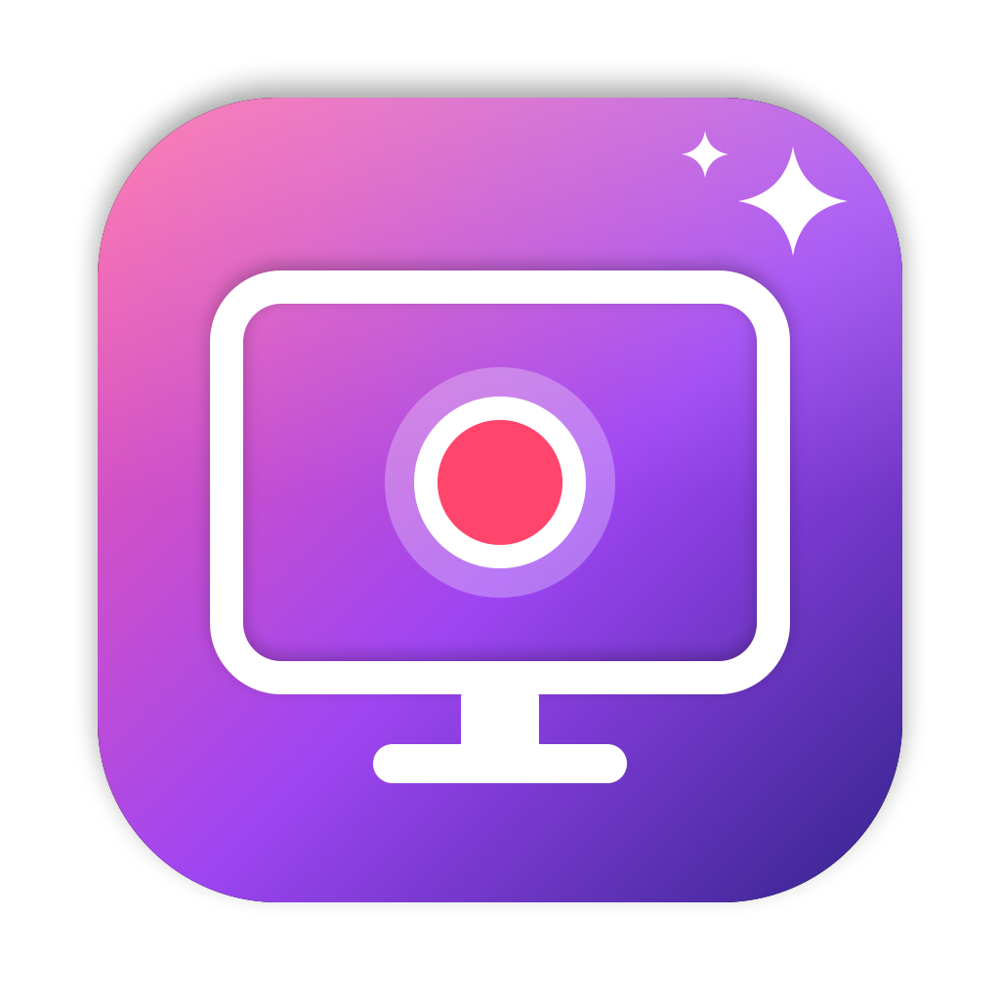

<p align="center"></p>

# Paola Screen Studio

App de grabación de escritorio: graba pantalla, ventana o área con cámara y micrófono,
y edita el video con zoom automático, cortes, anotaciones, fondos y exportación a MP4, GIF o ProRes.

| Carpeta | Plataforma | Estado |
| --- | --- | --- |
| [`mac/`](mac/) | macOS 15+ (Swift, SwiftUI, ScreenCaptureKit) | Funcional |
| [`windows/`](windows/) | Windows 10/11 (C#, WinUI 3) | En preparación |

## Levantar la app de Mac en desarrollo

### 1. Requisitos

- macOS 15 (Sequoia) o superior, en un Mac con Apple Silicon o Intel (la app se compila universal: `arm64` + `x86_64`)
- Xcode 16 o superior (incluye el toolchain de Swift 6). Tras instalarlo:

  ```bash
  sudo xcode-select -s /Applications/Xcode.app
  xcodebuild -runFirstLaunch
  swift --version   # debe mostrar Swift 6.x
  ```

### 2. Clonar

```bash
git clone git@github.com:danielpcode2/paola-scream-studio.git
cd paola-scream-studio/mac
```

### 3. Firma local (una sola vez)

macOS guarda los permisos de pantalla, cámara y micrófono según la firma de la app.
Sin una firma estable, cada recompilación vuelve a pedir los permisos. Crea una identidad
local (se guarda en tu llavero de inicio de sesión):

```bash
./scripts/create-signing-cert.sh
```

### 4. Compilar y abrir

```bash
./scripts/build-app.sh            # genera build/Paola Screen Studio.app (release, universal, firmada)
open "build/Paola Screen Studio.app"
```

La app vive en la barra de menús (y en el Dock si está activado). La primera grabación
pide permisos de **Grabación de pantalla y audio del sistema**, **Micrófono** y **Cámara**;
concédelos en *Ajustes del Sistema › Privacidad y seguridad* y reinicia la app.

Para abrir un proyecto directamente en el editor:

```bash
open "build/Paola Screen Studio.app" --args --open ~/Movies/"Paola Screen Studio"/<carpeta-del-proyecto>
```

### Usar la app en otro Mac

La app compilada es universal (Apple Silicon e Intel). Copia `build/Paola Screen Studio.app`
a la carpeta Aplicaciones del otro Mac. Como la firma es local, la primera vez ábrela con
clic derecho › **Abrir**; si macOS la bloquea, permítela en *Ajustes del Sistema › Privacidad
y seguridad*. También puedes clonar el repositorio y compilarla en ese Mac.

### 5. Tests

```bash
swift test
```

### 6. Ciclo de desarrollo

- Edita el código en `Sources/PaolaScreenStudio/` y vuelve a ejecutar `./scripts/build-app.sh`
  (cierra antes la app: `pkill -x PaolaScreenStudio`).
- También puedes abrir `Package.swift` en Xcode para depurar. Ten en cuenta que la grabación
  de pantalla necesita ejecutarse como `.app` firmada para que los permisos funcionen;
  `swift run` sirve para probar la interfaz, pero macOS puede bloquear la captura.
- Los proyectos grabados se guardan en `~/Movies/Paola Screen Studio/` (configurable en Ajustes).
- El logo se genera con `swift scripts/make-icon.swift` (crea `Resources/AppIcon.icns` y `Resources/Logo.png`).

### Problemas comunes

| Problema | Solución |
| --- | --- |
| Pide permisos en cada compilación | Ejecuta `./scripts/create-signing-cert.sh` y vuelve a compilar |
| La grabación sale negra | Concede "Grabación de pantalla" a *Paola Screen Studio* y reinicia la app |
| `swift: command not found` o versión 5.x | Instala Xcode 16+ y selecciónalo con `xcode-select` |
| No aparece el iPhone en *Dispositivo* | Conéctalo por cable, desbloquéalo y toca "Confiar" |

Más detalles de funciones y arquitectura en [`mac/README.md`](mac/README.md).

## Windows

Ver [`windows/README.md`](windows/README.md).
